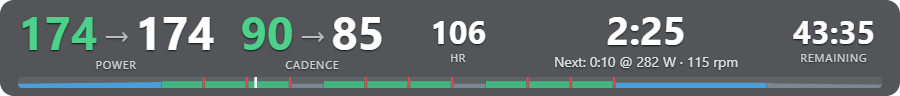
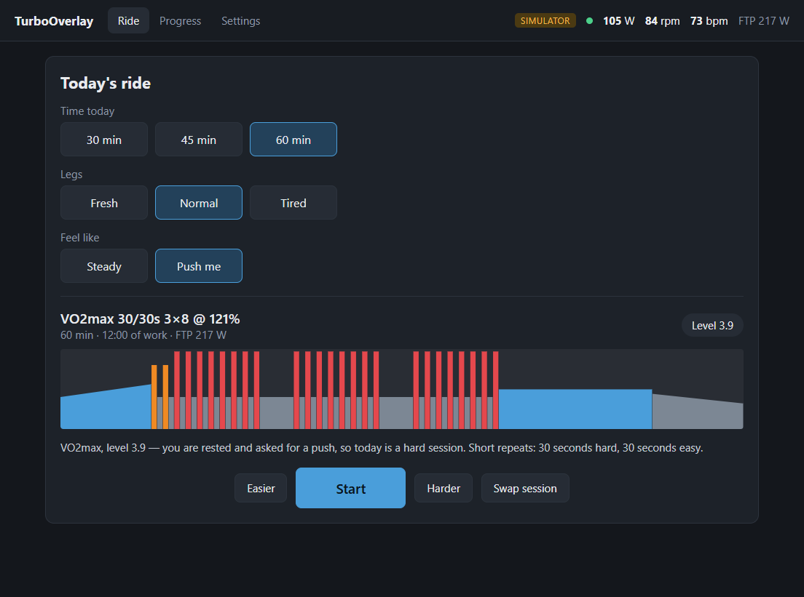
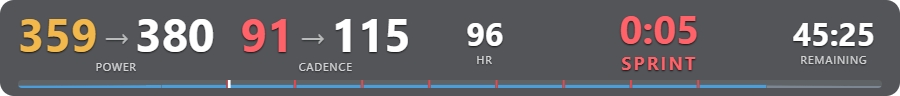
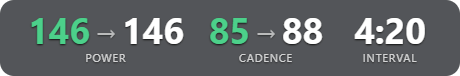
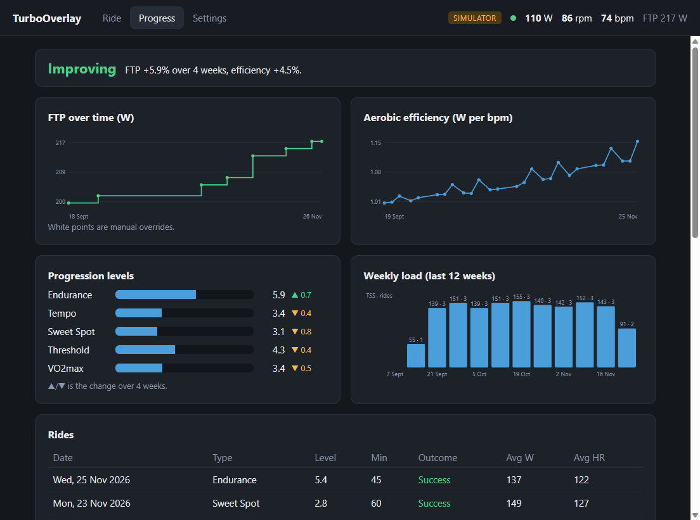
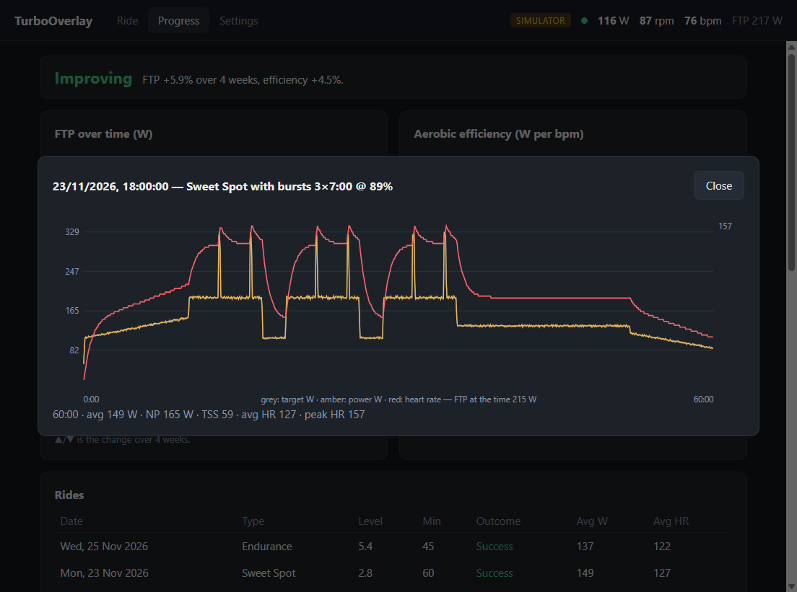

# TurboOverlay

An indoor cycling app that puts a small heads-up display on top of whatever video you are watching. You answer three questions, it builds a session, drives your smart trainer in ERG mode, and works out your FTP from your normal rides. There are no FTP tests.



It is for riders who want structured training without a rigid plan: ride when you can, say how your legs feel, and the app decides what is sensible today.

- **Windows** is the main platform. **Linux** is supported but less tested.
- Works with any trainer that speaks **ANT+ FE-C** and any **ANT+ heart-rate strap**, through a standard ANT+ USB stick. It was developed against a Saris Hammer.
- Fully offline. No account, no cloud, no sync. Your data is plain JSON on your own disk.

> **Status:** early (0.1). It works end to end on the hardware it was developed with. Treat it as a hobby project, not a product, and read the [safety note](#safety).

## What it does

**Three questions, then ride.** Time today, how your legs feel, and whether you want it steady or want a push. The app picks the session type and level, explains why, and lets you make it easier, harder, or swap it for a different shape of the same workout.



**An overlay that stays out of the way.** A thin strip over your video showing power and cadence as *current → target*, heart rate, time left in the interval, what is next, and where you are in the workout. It ignores mouse clicks, and global hotkeys control the ride while the video has focus.

| | |
|---|---|
| Sprint |  |
| Compact mode |  |

**Variety.** Each session type comes in several shapes that rotate: classic intervals, over-unders, bursts, sprints, 30/30s and 40/20s, and cadence drills.

**Intensity is earned, recovery is protected.** No hard session within 48 hours of the last one, at most two hard sessions in any 7 days, an easier return after a week off, and tired legs always get an easy day.

**FTP without tests.** The estimate comes from how your heart rate responds to power on ordinary rides. Intervals you complete set a floor under it and intervals you fail set a cap. It moves by at most 3% a week, and every change is recorded with the numbers behind it.

**One progress screen.** A plain verdict (improving, holding steady or slipping), FTP and aerobic efficiency over time, a level for each session type, weekly load, and every ride.





The screenshots use the built-in simulator with generated data.

## Install

1. Download the latest build from the [Releases page](https://github.com/argonautknight-sail/turbooverlay/releases/latest):
   - **Windows:** `TurboOverlay-Setup-x.y.z.exe` is the installer. `TurboOverlay-x.y.z-portable.exe` runs without installing.
   - **Linux:** `TurboOverlay-x.y.z.AppImage`. Make it executable (`chmod +x`) and run it.
2. Run it. The builds are unsigned, so Windows SmartScreen warns the first time: choose **More info → Run anyway**.
3. The first-run wizard pairs your trainer and heart-rate strap and asks for a starting FTP.

Before step 3 your ANT+ stick needs a one-off driver setup. See [Hardware setup](#hardware-setup).

No trainer to hand? Choose **Try the simulator** in the wizard to look around with a pretend rider. Switch to real devices later in Settings → Devices.

### Build from source

You need Node.js 22 or newer.

```
git clone https://github.com/argonautknight-sail/turbooverlay.git
cd turbooverlay
npm install
npm run dev           # run with the simulator
npm run dist:win      # or: build the installer and portable exe into dist/
```

On Linux use `npm run dist:linux` for an AppImage.

## Hardware setup

### Windows: the ANT+ stick needs the WinUSB driver

Install it once with [Zadig](https://zadig.akeo.ie/):

1. Plug in the ANT+ stick and close anything else that uses it (Garmin Express, Zwift and so on).
2. In Zadig choose **Options → List All Devices**.
3. Select the ANT stick (USB ID `0FCF 1008` or `0FCF 1009`).
4. Choose **WinUSB** and click **Replace Driver**.

Without this the app reports that a stick is plugged in but cannot be opened.

Replacing the driver takes the stick away from any program that relies on Garmin's own driver. To undo it, open Device Manager, find the stick, uninstall the device with "delete the driver software" ticked, and replug it.

### Linux

Add a udev rule so the stick does not need root, then replug it:

```
echo 'SUBSYSTEM=="usb", ATTRS{idVendor}=="0fcf", ATTRS{idProduct}=="100[89]", MODE="0666"' | sudo tee /etc/udev/rules.d/99-ant-stick.rules
sudo udevadm control --reload-rules
```

The transparent overlay needs a compositor. On Wayland, start the app with `--ozone-platform=x11` so always-on-top works. Under XWayland, global hotkeys only fire while an X11 window has focus, so they may not work over a Wayland-native browser; use the buttons in the main window instead.

### Only one program can use the stick

Close other training apps before starting TurboOverlay, and close TurboOverlay before starting them.

## Using it

1. **First run:** pedal to wake the trainer, put on the strap, press **Scan for devices**, choose both, then confirm your starting FTP and age. The FTP is only a starting point.
2. **Ride tab:** answer the three questions and check the preview. Press **Start**. The session waits until you pedal.
3. Start your video and go fullscreen. The overlay sits on top.
4. Afterwards you can say how it felt. That can change how the ride is scored and your level for that session type.

To check the overlay sits over your video player before a ride, use **Settings → Overlay → Show overlay now**.

### Hotkeys

Active during a ride or an overlay preview. All of them can be changed in Settings.

| Keys | Action |
|---|---|
| `Ctrl+Alt+P` | Pause / resume |
| `Ctrl+Alt+Up` / `Down` | Intensity ±5% |
| `Ctrl+Alt+N` | Skip interval |
| `Ctrl+Alt+O` | Cycle overlay: bottom → bottom compact → top → top compact |
| `Ctrl+Alt+H` | Hide / show overlay |

### Things worth knowing

- **Auto-pause:** stop pedalling for more than 3 seconds and the session pauses. Pedal to resume. After any pause the target ramps up from 50% over 8 seconds once you are above 50 rpm, so the trainer does not lock up.
- **Dropouts:** if the trainer goes quiet the session pauses and shows "Reconnecting…". If only the heart-rate strap goes quiet the ride carries on.
- **Target cadence** is guidance only. It never affects how a ride is scored.
- **Sprints:** in ERG mode a trainer takes a second or two to catch up, so wind up your cadence as the sprint starts.
- **Cooling:** indoor heart rate depends heavily on cooling. Use the same fan setup every ride, or a change of fan will look like a change of fitness.
- **Calibration:** do a spindown in your trainer maker's app now and then. This app does not calibrate.
- **Hardware test:** Settings has a manual power slider and a 10-minute test workout for checking the trainer follows the target.

## Safety

This is training software written as a hobby project. It is not medical advice and has had no medical review.

- Hard interval training carries risk. If you have, or might have, a heart or other health condition, talk to a doctor before using it.
- The app eases the target by 5% if your heart rate stays above a ceiling for 20 seconds. The default ceiling is your estimated maximum plus 3 bpm, and you can set your own in Settings. This is a convenience, not a safety device: it depends on a strap that can drop out or misread.
- Maximum heart rate starts from the rough `220 − age` rule and only rises when a ride records a higher value. If you know your real maximum, enter it in Settings.
- Stop if you feel unwell.

## Where your data lives

Plain JSON in the app's user-data folder. The exact path is shown at the bottom of Settings (on Windows it is under `%APPDATA%`).

- `profile.json` — FTP history, every FTP estimate with its inputs, max HR, levels and their history, settings, paired device IDs.
- `rides/<date>.json` — the plan, the FTP, max HR and levels in force at the start, and the summary.
- `rides/<date>.samples.ndjson` — one line per second, written during the ride. If the app is killed mid-ride, the ride is recovered from this file on the next launch.

Rides shorter than 60 seconds are discarded. Nothing leaves your computer.

## Development

| Command | What it does |
|---|---|
| `npm run dev` | Run with the simulator |
| `npm run dev:real` | Run with real ANT+ devices |
| `npm test` | Unit tests |
| `npm run typecheck` | TypeScript check |
| `npm run format` | Prettier |
| `npm run build` | Build into `out/` |
| `npm run dist:win` / `dist:linux` | Package into `dist/` |

To publish a release, set the version in `package.json`, then push a matching tag (`git tag v0.1.0 && git push origin v0.1.0`). A GitHub Actions workflow runs the tests, builds the Windows and Linux packages and attaches them to the release.

Set `TURBO_DATA_DIR` to a folder to run a separate copy with its own data, alongside your real one. `--sim` and `--real` on the command line override the device source.

```
src/shared/              types and the IPC surface
src/main/coach/          session generator, progression, FTP estimator, metrics, analytics
src/main/engine/         WorkoutEngine: runs a session one second at a time
src/main/devices/        trainer and heart-rate services: ANT+ and simulator
src/main/store/          profile and ride files
src/main/controller.ts   the 1 Hz loop: devices → engine → recorder → windows
src/main/index.ts        windows, overlay, hotkeys, IPC
src/renderer/            main window and overlay (React)
tests/                   Vitest, including a multi-week simulated-rider test
docs/DESIGN.md           how sessions are built, how levels move, how FTP is estimated
```

The coaching logic and the workout engine are pure TypeScript with no Electron or file access, and are covered by unit tests. All timing runs in the main process; the windows only display what they are sent.

The stack is Electron, TypeScript, React and Vite, with [incyclist-ant-plus](https://github.com/incyclist/ant-plus) for ANT+.

## Limits

- ANT+ only. Bluetooth trainers and straps are not supported.
- ERG mode only. No slope or resistance modes, no virtual worlds.
- No import or export to other training services.
- One rider per installation.
- Tested on one trainer model. Other FE-C trainers should work but have not been tried.

## Licence

[MIT](LICENSE).

TurboOverlay is an independent project. It is not affiliated with or endorsed by Garmin, Saris, Zwift, TrainerRoad or any video service. ANT+ is a trademark of Garmin.
